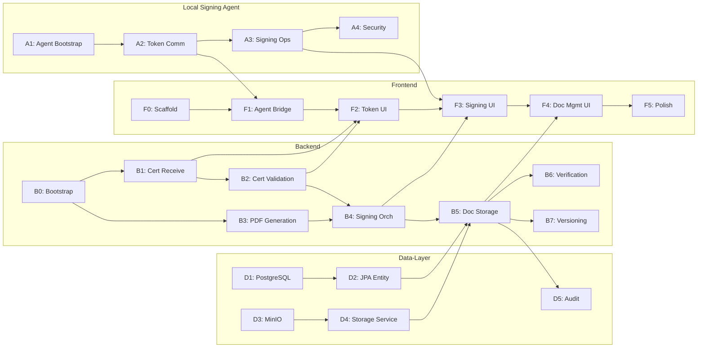

# USB-Based Digital Document Signing — Implementation Plan (v2)

> [!NOTE]
> Four parallel tracks: **Backend**, **Frontend**, **Data-Layer**, **Local Signing Agent**.
> Each track is split into phases; each phase into discrete tasks.
> Dependencies across tracks are called out inline.

> [!IMPORTANT]
> **Review changes (v2):** Added Local Signing Agent as a dedicated track. Added phases for
> security/config, error handling, API contracts, testing, DevOps, and document versioning.
> Expanded DB schema. Added acceptance criteria per phase.

---

## Backend

### Phase B0 — Project Bootstrap & Configuration

| # | Task | Details |
|---|------|---------|
| B0.1 | Spring Boot init | Spring Initializr — Java 21, Spring Web, Spring Data JPA, Actuator, Validation |
| B0.2 | Multi-profile config | `application.yml` with `dev`, `test`, `prod` profiles; externalize secrets via env vars |
| B0.3 | CORS configuration | `WebMvcConfigurer` — allow frontend origin, restrict methods; configurable per profile |
| B0.4 | HTTPS / TLS setup | Self-signed cert for dev; document production TLS termination strategy |
| B0.5 | Global exception handler | `@ControllerAdvice` — map domain exceptions → RFC 7807 Problem Detail JSON |
| B0.6 | Request logging filter | Log request ID, method, path, duration; correlate with MDC |
| B0.7 | OpenAPI / Swagger | `springdoc-openapi` dependency; annotate all endpoints; generate spec on build |
| B0.8 | Health & readiness probes | Actuator `/health` with custom DB + MinIO indicators |

**Acceptance:** App starts on all profiles, Swagger UI accessible, CORS working with frontend origin, structured error responses returned.

---

### Phase B1 — PKCS#11 Token Integration (Local Agent Coordination)

| # | Task | Details |
|---|------|---------|
| B1.1 | Agent comm protocol design | Define REST/WebSocket contract between backend and local signing agent (see Agent track A1) |
| B1.2 | Certificate receive endpoint | `POST /api/certificates` — receive PEM/DER cert forwarded from frontend (which got it from agent) |
| B1.3 | Certificate deserialization | Parse incoming X.509 bytes → `X509Certificate` object |
| B1.4 | Identity extraction service | Extract CN, O, OU, serial, issuer DN, subject DN, expiry, key-usage from parsed cert |
| B1.5 | DTO & response contract | `CertificateInfoResponse` — parsed identity fields + raw PEM + fingerprint |

> [!WARNING]
> Original plan had the backend directly interfacing with PKCS#11. The spec clearly states
> USB token is on the **employee's machine** — backend cannot access it. All token I/O
> belongs in the Local Signing Agent track. Backend only receives the certificate over HTTPS.

**Acceptance:** Backend can receive a PEM cert, parse it, and return structured identity JSON.

---

### Phase B2 — Certificate Validation

| # | Task | Details |
|---|------|---------|
| B2.1 | Trust-store configuration | Load trusted CA certs from configurable JKS/PKCS12 path; support hot-reload |
| B2.2 | Chain validation service | `CertPathValidator` — build chain from cert → intermediates → root CA |
| B2.3 | Expiry check | Reject expired / not-yet-valid certs with specific error code |
| B2.4 | Revocation check (CRL) | Download and cache CRL distribution points from cert |
| B2.5 | Revocation check (OCSP) | OCSP responder lookup; configurable fallback order CRL→OCSP |
| B2.6 | Revocation toggle | Feature flag to disable revocation checks in dev/PoC |
| B2.7 | Key-usage verification | Assert `digitalSignature` + optionally `nonRepudiation` bits |
| B2.8 | Validation result model | `CertValidationResult` — per-check pass/fail + reasons + overall status |
| B2.9 | Validation endpoint | `POST /api/certificates/validate` — accepts cert PEM, returns `CertValidationResult` |
| B2.10 | Unit tests | Test with valid, expired, revoked, wrong-key-usage, untrusted-CA certs |

**Acceptance:** Endpoint correctly rejects bad certs with specific failure reasons; passes valid certs.

---

### Phase B3 — PDF Generation

| # | Task | Details |
|---|------|---------|
| B3.1 | PDFBox dependency | `pdfbox 3.x` + `pdfbox-tools` in `pom.xml` |
| B3.2 | Template service | `PdfGenerationService` — configurable template; employee name, ID, date, content body |
| B3.3 | Signature placeholder | Reserve empty `PDSignatureField` with adequate byte-range (size matters for CMS container) |
| B3.4 | Font & encoding | Embed fonts for Unicode support; test with non-ASCII employee names |
| B3.5 | Generation endpoint | `POST /api/documents/generate` — accepts identity payload + document content, returns unsigned PDF |
| B3.6 | Idempotency guard | If document already exists for same employee+content hash, return existing unsigned PDF or error |
| B3.7 | Unit tests | Validate generated PDF opens correctly, has signature field, contains expected text |

**Acceptance:** Generates valid PDF with visible employee info and empty signature field.

---

### Phase B4 — Cryptographic Signing Orchestration

| # | Task | Details |
|---|------|---------|
| B4.1 | EU DSS dependency | `dss-pades-pdfbox` + `dss-crl-parser` + `dss-tsl-validation` in `pom.xml` |
| B4.2 | Signing session model | Create `SigningSession` — tracks state machine: `INITIATED → DIGEST_SENT → SIGNED → FINALIZED → FAILED` |
| B4.3 | Digest computation | Compute PDF byte-range hash (SHA-256); return Base64-encoded digest to frontend/agent |
| B4.4 | Digest endpoint | `POST /api/documents/{id}/digest` — returns digest for agent to sign |
| B4.5 | Signature receive endpoint | `POST /api/documents/{id}/signature` — receives raw CMS/PKCS7 signature bytes |
| B4.6 | Signature embedding | Embed received signature into PDF's reserved byte-range |
| B4.7 | PAdES compliance | Validate container is PAdES-Baseline-B; add signing-time signed attribute |
| B4.8 | Post-sign verification | Immediately verify embedded signature; update `SigningSession` state |
| B4.9 | Session timeout | Auto-expire signing sessions not completed within configurable TTL (e.g., 5 min) |
| B4.10 | Concurrency guard | Prevent duplicate sign requests for same document; lock on `documentId` |
| B4.11 | Integration tests | Full sign flow with test cert + SoftHSM or mock agent |

> [!TIP]
> Split the monolithic `POST /api/documents/sign` into `digest` + `signature` endpoints.
> This matches the actual async flow: backend sends digest → agent signs → agent returns signature.

**Acceptance:** Full sign round-trip works; session state machine transitions correctly; duplicate/expired requests rejected.

---

### Phase B5 — Document Storage & Retrieval

| # | Task | Details |
|---|------|---------|
| B5.1 | MinIO client config | `io.minio:minio` dependency; `MinioClient` Spring bean; configurable endpoint/creds |
| B5.2 | Upload service | Upload finalized PDF; key pattern `{employeeId}/{yyyy-MM}/{docId}.pdf` |
| B5.3 | SHA-256 hashing | Compute doc hash before upload; compare after upload (round-trip integrity) |
| B5.4 | Metadata persistence | `@Transactional` — save `SignedDocument` + upload to MinIO atomically (compensating delete on failure) |
| B5.5 | Retrieve metadata | `GET /api/documents/{id}` — return metadata JSON |
| B5.6 | Download PDF | `GET /api/documents/{id}/download` — stream from MinIO; set `Content-Disposition` header |
| B5.7 | List documents | `GET /api/documents?employeeId=...&page=0&size=20` — paginated, sorted by `signedAt` desc |
| B5.8 | Duplicate detection | Before storing, check if identical `documentHash` already exists |
| B5.9 | Content-type validation | Verify uploaded bytes are a valid PDF before persisting |
| B5.10 | Integration tests | Upload → retrieve → compare hash; pagination; error cases |

**Acceptance:** Signed PDF stored in MinIO, metadata in DB, round-trip download matches hash, pagination works.

---

### Phase B6 — Signature Verification

| # | Task | Details |
|---|------|---------|
| B6.1 | Integrity check service | Download from MinIO → re-hash → compare with DB `documentHash` |
| B6.2 | Signature validation | EU DSS `SignedDocumentValidator` — verify CMS signature is valid |
| B6.3 | Signer identity confirmation | Extract signer cert from PDF sig → match serial/subject with DB record |
| B6.4 | Verification result model | `VerificationResult` — integrity pass/fail, sig valid/invalid, signer match, timestamp |
| B6.5 | Verification endpoint | `GET /api/documents/{id}/verify` — returns `VerificationResult` |
| B6.6 | Batch verification job | Scheduled job to verify all stored documents periodically (optional) |
| B6.7 | Unit tests | Test tampered PDF, swapped hash, valid doc |

**Acceptance:** Tampered docs flagged; valid docs pass; signer identity matched.

---

### Phase B7 — Document Versioning

| # | Task | Details |
|---|------|---------|
| B7.1 | Version model | Add `version` (int) + `parent_document_id` (nullable FK) to `SignedDocument` |
| B7.2 | Version migration | Flyway migration to add columns |
| B7.3 | Re-sign flow | When doc needs modification: generate new PDF → sign → store as version N+1 linked to parent |
| B7.4 | Version history endpoint | `GET /api/documents/{id}/versions` — returns ordered version chain |
| B7.5 | Latest-version redirect | `GET /api/documents/{id}/latest` — redirect to most recent version |

**Acceptance:** Modified documents create new versions; version history is traversable.

---

## Local Signing Agent

> [!IMPORTANT]
> The original plan had no dedicated track for this component. The spec's Layer 2 (Local Signing Agent)
> is a **separate process** running on the employee's machine. It bridges React ↔ USB token.

### Phase A1 — Agent Bootstrap

| # | Task | Details |
|---|------|---------|
| A1.1 | Technology decision | Java (shared codebase) vs. Go/Rust (small binary) vs. Electron (if bundled with frontend) |
| A1.2 | Project scaffold | Standalone app; localhost HTTP server on configurable port (e.g., `localhost:9876`) |
| A1.3 | CORS for localhost | Allow only `localhost` + frontend origin |
| A1.4 | Health endpoint | `GET /health` — agent alive check; frontend polls this |
| A1.5 | Packaging | Installer/portable exe for Windows; `.deb`/`.dmg` for Linux/Mac (PoC: just runnable JAR) |

### Phase A2 — PKCS#11 Token Communication

| # | Task | Details |
|---|------|---------|
| A2.1 | PKCS#11 provider config | SunPKCS11 config file; native lib path configurable |
| A2.2 | Token detection | Enumerate slots; detect token insertion/removal |
| A2.3 | Certificate read | Read X.509 cert from first available signing slot |
| A2.4 | Read endpoint | `GET /api/token/certificate` — returns cert in PEM + parsed identity preview |
| A2.5 | Multiple token handling | Handle multiple slots; let user pick if >1 token present |

### Phase A3 — Signing Operations

| # | Task | Details |
|---|------|---------|
| A3.1 | PIN authentication | Accept PIN from frontend; open authenticated PKCS#11 session |
| A3.2 | Digest signing | Receive Base64 digest from frontend → sign with token private key → return raw signature |
| A3.3 | Sign endpoint | `POST /api/token/sign` — accepts `{digest, algorithm}`, returns `{signature}` |
| A3.4 | Session cleanup | Close PKCS#11 session + logout after signing; clear PIN from memory |
| A3.5 | PIN security | Never log, persist, or echo PIN; zero-out char arrays after use |
| A3.6 | Timeout | Auto-close session if idle > configurable seconds |

### Phase A4 — Agent Security & Hardening

| # | Task | Details |
|---|------|---------|
| A4.1 | Localhost-only binding | Bind HTTP server to `127.0.0.1` only; reject non-loopback |
| A4.2 | Origin validation | Check `Origin` header; reject non-whitelisted origins |
| A4.3 | Request signing / nonce | Optional HMAC or nonce-based auth between frontend and agent |
| A4.4 | Rate limiting | Limit sign requests per minute to prevent brute-force PIN attempts |
| A4.5 | Logging | Structured logs; never log PIN or private key material |

**Acceptance:** Agent runs locally, detects token, reads cert, signs digest, PIN never leaks.

---

## Frontend

### Phase F0 — Project Bootstrap

| # | Task | Details |
|---|------|---------|
| F0.1 | Vite + React + TypeScript | Project scaffold; ESLint + Prettier config |
| F0.2 | UI framework | Choose and install: Tailwind CSS / MUI / shadcn-ui |
| F0.3 | State management | Zustand / React Context for signing workflow state |
| F0.4 | Routing | React Router v6 — `/`, `/sign`, `/documents`, `/documents/:id` |
| F0.5 | Environment config | `.env` files — backend URL, agent URL, feature flags |
| F0.6 | API client layer | Axios instance with interceptors: base URL, auth headers, error transform, retry |

**Acceptance:** App builds, routes work, API client configured.

---

### Phase F1 — Local Agent Bridge

| # | Task | Details |
|---|------|---------|
| F1.1 | Agent discovery | Poll `localhost:9876/health`; show "agent not running" if down |
| F1.2 | Agent status indicator | Persistent header badge: 🟢 connected / 🔴 disconnected |
| F1.3 | Agent API client | Typed client for agent endpoints (cert read, sign) |
| F1.4 | Reconnection logic | Auto-retry with backoff when agent connection drops |

**Acceptance:** Frontend detects agent presence/absence and communicates reliably.

---

### Phase F2 — Token & Certificate UI

| # | Task | Details |
|---|------|---------|
| F2.1 | Token detection view | "Insert token" prompt → call agent `/api/token/certificate` → show status |
| F2.2 | Certificate display card | Render: subject CN, organization, issuer, serial, valid-from, valid-to, key-usage |
| F2.3 | Backend validation trigger | Send cert PEM to backend `POST /api/certificates/validate` |
| F2.4 | Validation result display | Checklist UI: ✅ chain valid, ✅ not expired, ✅ not revoked, ✅ key-usage OK (or ❌ with reason) |
| F2.5 | Confirmation step | "I confirm my identity — proceed to signing" button; disabled until all checks pass |
| F2.6 | Certificate error states | Handle: no token, unreadable cert, validation failure — with clear user messaging |

**Acceptance:** Full cert read → validate → confirm flow with proper error states.

---

### Phase F3 — Signing Workflow UI

| # | Task | Details |
|---|------|---------|
| F3.1 | Generate document trigger | Call backend `/api/documents/generate`; show progress |
| F3.2 | PIN prompt dialog | Modal with masked input; "Show PIN" toggle; submit/cancel |
| F3.3 | PIN security | Never store PIN in state after submission; clear input field on submit |
| F3.4 | Signing flow orchestration | Sequence: generate → get digest from backend → send digest+PIN to agent → receive signature → send signature to backend → finalized |
| F3.5 | Progress stepper | Visual step indicator: Generate → Digest → Sign → Finalize → ✅ |
| F3.6 | Success view | Show: document name, signed-at, signature status, doc ID, download button |
| F3.7 | Failure handling | Specific errors: wrong PIN, token removed, timeout, backend error — with retry option |
| F3.8 | Sign-again prevention | If doc already signed, show existing signature info instead of re-sign option |

**Acceptance:** Complete signing flow with progress feedback, error handling, and PIN security.

---

### Phase F4 — Document Management UI

| # | Task | Details |
|---|------|---------|
| F4.1 | Document list page | Paginated table: name, date, status; sort/filter controls |
| F4.2 | Document detail page | Full metadata display + signature verification status |
| F4.3 | PDF viewer | Inline preview using `react-pdf` or `<embed>` |
| F4.4 | Download action | Stream from backend; trigger browser download with correct filename |
| F4.5 | Verify action | Call `GET /api/documents/{id}/verify`; show verification result inline |
| F4.6 | Version history | If versioning enabled, show version chain with links |
| F4.7 | Empty states | "No documents yet" illustration; first-time user guidance |

**Acceptance:** List, view, download, verify documents. Pagination and empty states work.

---

### Phase F5 — Polish, Error Handling & UX

| # | Task | Details |
|---|------|---------|
| F5.1 | Global error boundary | Catch unhandled errors; display friendly fallback UI |
| F5.2 | API error interceptor | Map backend Problem Detail responses → user-friendly messages |
| F5.3 | Loading skeletons | Skeleton placeholders for all async-loaded views |
| F5.4 | Toast notifications | Success/error/info toasts for all user actions |
| F5.5 | Responsive layout | Mobile-friendly breakpoints; touch-friendly buttons |
| F5.6 | Keyboard navigation | Tab order, focus management in modals, Enter-to-submit |
| F5.7 | Accessibility basics | ARIA labels, contrast ratios, screen-reader tested |

**Acceptance:** No unhandled errors, graceful degradation, WCAG-AA basics met.

---

## Data-Layer

### Phase D1 — PostgreSQL Setup

| # | Task | Details |
|---|------|---------|
| D1.1 | Docker Compose service | PostgreSQL 16; named volume for data persistence |
| D1.2 | Spring datasource config | `application.yml` — JDBC URL, credentials (from env vars), HikariCP pool settings |
| D1.3 | Flyway setup | `flyway-core` dependency; `db/migration/` folder; baseline on migrate |
| D1.4 | V1 migration — `signed_document` | Create table (expanded schema below) |
| D1.5 | V2 migration — indexes | Composite index on `(employee_id, signed_at)` |

**Expanded `signed_document` schema:**

```sql
CREATE TABLE signed_document (
    id                  UUID PRIMARY KEY DEFAULT gen_random_uuid(),
    employee_id         VARCHAR(100)   NOT NULL,
    employee_name       VARCHAR(255),
    certificate_serial  VARCHAR(255)   NOT NULL,
    issuer_dn           VARCHAR(1024),
    subject_dn          VARCHAR(1024),
    certificate_expiry  TIMESTAMPTZ,
    document_name       VARCHAR(255)   NOT NULL,
    document_content_type VARCHAR(50)  NOT NULL DEFAULT 'application/pdf',
    storage_key         VARCHAR(512)   NOT NULL UNIQUE,
    document_hash       VARCHAR(64)    NOT NULL,
    file_size_bytes     BIGINT,
    version             INT            NOT NULL DEFAULT 1,
    parent_document_id  UUID           REFERENCES signed_document(id),
    signed_at           TIMESTAMPTZ    NOT NULL,
    signature_status    VARCHAR(20)    NOT NULL DEFAULT 'UNKNOWN',
    created_at          TIMESTAMPTZ    NOT NULL DEFAULT now(),
    updated_at          TIMESTAMPTZ    NOT NULL DEFAULT now()
);

CREATE INDEX idx_signed_doc_employee       ON signed_document(employee_id);
CREATE INDEX idx_signed_doc_employee_date  ON signed_document(employee_id, signed_at DESC);
CREATE INDEX idx_signed_doc_hash           ON signed_document(document_hash);
CREATE INDEX idx_signed_doc_parent         ON signed_document(parent_document_id);
```

> [!NOTE]
> **Schema additions over v1:** `employee_name`, `issuer_dn`, `subject_dn`, `certificate_expiry`,
> `document_content_type`, `file_size_bytes`, `version`, `parent_document_id`, `updated_at`,
> unique constraint on `storage_key`, indexes on hash and parent.

---

### Phase D2 — JPA Entity & Repository

| # | Task | Details |
|---|------|---------|
| D2.1 | `SignedDocument` entity | `@Entity` with all columns; `@PreUpdate` for `updatedAt`; UUID generation strategy |
| D2.2 | Repository interface | `SignedDocumentRepository extends JpaRepository<SignedDocument, UUID>` |
| D2.3 | Custom queries | `findByEmployeeIdOrderBySignedAtDesc(String, Pageable)` |
| D2.4 | Custom queries | `findByDocumentHash(String)` — duplicate detection |
| D2.5 | Custom queries | `findByParentDocumentIdOrderByVersionDesc(UUID)` — version chain |
| D2.6 | Specification/criteria | Dynamic filtering by date range, status, employee |
| D2.7 | Repository tests | `@DataJpaTest` with Testcontainers PostgreSQL |

**Acceptance:** All queries work against real PostgreSQL via Testcontainers.

---

### Phase D3 — MinIO Setup

| # | Task | Details |
|---|------|---------|
| D3.1 | Docker Compose service | MinIO + console; named volume; env-based credentials |
| D3.2 | MinIO client bean | `MinioClient` Spring bean with endpoint, access key, secret key from config |
| D3.3 | Bucket initialization | `@PostConstruct` or `ApplicationRunner` — create `signed-documents` bucket if absent |
| D3.4 | Bucket policy | Set bucket to private (no public access); access only through backend |
| D3.5 | Connection health check | Custom Actuator health indicator for MinIO connectivity |

**Acceptance:** MinIO running, bucket created, health check green, no public access.

---

### Phase D4 — Storage Service

| # | Task | Details |
|---|------|---------|
| D4.1 | `DocumentStorageService` interface | Define contract: `upload`, `download`, `exists`, `delete`, `getMetadata` |
| D4.2 | MinIO implementation | `MinioDocumentStorageService implements DocumentStorageService` |
| D4.3 | Upload | `putObject` — key `{employeeId}/{yyyy-MM}/{docId}.pdf`; set content-type metadata |
| D4.4 | Download | `getObject` → `InputStream`; caller responsible for streaming to HTTP response |
| D4.5 | Existence check | `statObject` — verify before download; throw `DocumentNotFoundException` |
| D4.6 | Delete | `removeObject` — soft-delete option (move to `archived/` prefix) vs hard delete |
| D4.7 | Presigned URL (optional) | Generate time-limited presigned download URL for direct browser download |
| D4.8 | Integration tests | Testcontainers MinIO; upload → download → compare bytes |

> [!TIP]
> Interface-based design (D4.1) allows swapping MinIO for S3, Azure Blob, or local filesystem
> in tests without changing business logic.

**Acceptance:** Upload/download round-trip preserves bytes; not-found throws correctly.

---

### Phase D5 — Audit & Integrity

| # | Task | Details |
|---|------|---------|
| D5.1 | `audit_log` table | `id`, `action` (SIGN, DOWNLOAD, VERIFY, DELETE), `actor_id`, `document_id`, `ip_address`, `user_agent`, `details` (JSONB), `created_at` |
| D5.2 | Flyway migration | V3 migration for `audit_log` table + index on `(document_id, created_at)` |
| D5.3 | `AuditLog` entity + repo | JPA entity; append-only (no update/delete operations) |
| D5.4 | `AuditService` | Log events from service layer; async (`@Async`) to avoid blocking main flow |
| D5.5 | Audit interceptor / AOP | `@Aspect` on controller methods to auto-log access events |
| D5.6 | Audit query endpoint | `GET /api/documents/{id}/audit` — returns audit trail for a document |
| D5.7 | Hash integrity job | `@Scheduled` — daily: re-download from MinIO, re-hash, compare with DB; alert on mismatch |
| D5.8 | Integrity alert | Log WARN + update `signature_status` to `INTEGRITY_FAILED` on hash mismatch |

**Acceptance:** All sign/download/verify actions logged; integrity job catches tampered files.

---

## DevOps & Infrastructure

### Phase X1 — Docker Compose & Local Dev

| # | Task | Details |
|---|------|---------|
| X1.1 | Full `docker-compose.yml` | PostgreSQL + MinIO + Spring Boot app (all services) |
| X1.2 | Dev compose override | `docker-compose.override.yml` — mount source, debug port, hot-reload |
| X1.3 | Seed data script | SQL script or `CommandLineRunner` to insert test employee + test cert |
| X1.4 | README — local setup | Step-by-step: prerequisites, `docker compose up`, access URLs |

### Phase X2 — Testing Strategy

| # | Task | Details |
|---|------|---------|
| X2.1 | Unit test framework | JUnit 5 + Mockito for backend; Vitest + Testing Library for frontend |
| X2.2 | Integration test infra | Testcontainers for PostgreSQL + MinIO; `@SpringBootTest` slices |
| X2.3 | Contract tests | OpenAPI-driven request/response validation; catch frontend/backend drift |
| X2.4 | E2E smoke test | Scripted test: mock agent → cert → validate → generate → sign → store → retrieve → verify |
| X2.5 | SoftHSM for CI | SoftHSM2 setup for testing PKCS#11 in CI without physical token |
| X2.6 | Test certificates | Generate self-signed CA + employee cert + expired cert + revoked cert for test suite |
| X2.7 | Frontend component tests | Test each major view: token, signing flow, document list |
| X2.8 | Coverage gates | Enforce minimum coverage: 70% backend, 60% frontend |

### Phase X3 — CI Pipeline (optional for PoC)

| # | Task | Details |
|---|------|---------|
| X3.1 | GitHub Actions / GitLab CI | Build → test → lint → package |
| X3.2 | Docker image build | Multi-stage Dockerfile for Spring Boot app |
| X3.3 | Frontend build | Vite production build; static asset output |
| X3.4 | Artifact publish | Push Docker image to registry on merge to main |

---

## Cross-Track Dependencies



---

## Suggested Execution Order

| Order | Phase | Track | Depends On | Parallel Group |
|-------|-------|-------|------------|----------------|
| 1 | D1 — PostgreSQL Setup | Data-Layer | — | 🔵 Group 1 |
| 1 | D3 — MinIO Setup | Data-Layer | — | 🔵 Group 1 |
| 1 | B0 — Project Bootstrap | Backend | — | 🔵 Group 1 |
| 1 | A1 — Agent Bootstrap | Agent | — | 🔵 Group 1 |
| 1 | F0 — Frontend Scaffold | Frontend | — | 🔵 Group 1 |
| 2 | D2 — JPA Entity & Repo | Data-Layer | D1 | 🟢 Group 2 |
| 2 | D4 — Storage Service | Data-Layer | D3 | 🟢 Group 2 |
| 2 | A2 — Token Communication | Agent | A1 | 🟢 Group 2 |
| 2 | B1 — Cert Receive | Backend | B0 | 🟢 Group 2 |
| 2 | F1 — Agent Bridge | Frontend | F0, A1 | 🟢 Group 2 |
| 3 | B2 — Cert Validation | Backend | B1 | 🟡 Group 3 |
| 3 | B3 — PDF Generation | Backend | B0 | 🟡 Group 3 |
| 3 | A3 — Signing Operations | Agent | A2 | 🟡 Group 3 |
| 3 | F2 — Token & Cert UI | Frontend | F1, B1, B2 | 🟡 Group 3 |
| 4 | B4 — Signing Orchestration | Backend | B2, B3, A3 | 🟠 Group 4 |
| 4 | A4 — Agent Security | Agent | A3 | 🟠 Group 4 |
| 5 | B5 — Doc Storage & Retrieval | Backend | B4, D2, D4 | 🔴 Group 5 |
| 5 | F3 — Signing Workflow UI | Frontend | F2, B4, A3 | 🔴 Group 5 |
| 6 | B6 — Signature Verification | Backend | B5 | 🟣 Group 6 |
| 6 | B7 — Document Versioning | Backend | B5 | 🟣 Group 6 |
| 6 | F4 — Document Mgmt UI | Frontend | F3, B5 | 🟣 Group 6 |
| 7 | D5 — Audit & Integrity | Data-Layer | D2, B5 | ⚪ Group 7 |
| 7 | F5 — Polish & UX | Frontend | F4 | ⚪ Group 7 |
| 8 | X1 — Docker Compose | DevOps | All services | 🔲 Group 8 |
| 8 | X2 — Testing Strategy | DevOps | All code | 🔲 Group 8 |
| 9 | X3 — CI Pipeline | DevOps | X1, X2 | ⬛ Group 9 |

---

## Risk Register

| Risk | Impact | Mitigation |
|------|--------|------------|
| PKCS#11 native lib compatibility across OS | High | Test with SoftHSM early; document supported tokens |
| PAdES signature container size miscalculation | Medium | Oversize placeholder (32KB); test with real CMS containers |
| PIN brute-force via compromised frontend | High | Agent-side rate limiting (A4.4); lockout after N failures |
| MinIO downtime loses access to signed PDFs | High | MinIO replication or backup; health checks |
| Certificate revocation checks add latency | Medium | Cache CRLs; OCSP with timeout; toggle for PoC |
| Browser blocks localhost agent requests | Medium | Proper CORS; consider browser extension if blocked |
| Large PDF generation OOM | Low | Stream-based PDF writing; limit content size |

---

## PoC Scope Boundary

> [!CAUTION]
> For PoC, the following are **out of scope** but flagged for production:
> - User authentication/authorization (JWT, OAuth2)
> - Multi-tenant employee isolation
> - High availability / clustering
> - Production TLS certificate management
> - PDF template designer UI
> - Batch signing
> - Email notifications
> - Document expiry / retention policy
